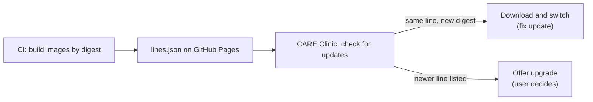

# CARE images and release lines

CARE Clinic no longer builds CARE from source on the clinic's computer. CI
builds the backend and frontend once per commit, publishes the images, and
lists them in a small manifest (`lines.json`). A clinic downloads images and
only builds locally when it needs something the published image cannot do
(plugins, or a frontend setting that is compiled in).

This page is the contract between the CI side (owned on GitHub) and the app.

## Personal update testing

The `praffq` test configuration uses CARE line `3`, built from `develop` in
`praffq/care` and `praffq/care_fe`. This is a test label, not an upstream
stable CARE version: development branches can contain more than bug fixes.

Clinic `0.1.11` is the baseline with the personal app-update endpoint and CARE
3 configuration. Clinic `0.1.12` tests an app-only update: it keeps the same
CARE line and engine version. New commits published on that line are CARE-only
updates; they do not change the Clinic version.

Line `3.1` tests upgrades using `ENG-737` in `praffq/care` and
`bodhi/questionnaire-actions` in `praffq/care_fe`, copied from upstream.
These are test branches, not an official upstream CARE 3.1 release.
Clinic `0.1.15` unlocks this optional upgrade; no new app release is needed.
The recommended/default line remains `3`, and publishing line `3.1` does not
automatically move clinics off CARE 3. Leave line `3` published and maintained
to keep delivering its fixes. An installed preview
clinic must explicitly upgrade to line `3`; changing the app's default does
not move existing clinics.

The old `preview` entry is archived: image CI keeps its already-published
images without building new ones. This preserves the ordering needed to offer
an upgrade from an installed preview clinic to CARE 3. Archived entries use
`"archived": true` in `lines.source.json`; they are not maintained release lines.

## Vocabulary

| Term | Meaning |
| --- | --- |
| Release line | A supported CARE version family, for example `v3.1`. Each line follows one backend branch and one frontend branch that only receive fixes. |
| Line manifest | `lines.json`, served from `CARE_LINES_URL`. Lists every line, oldest first, with the image digests of its latest build. |
| Runtime setting | A frontend setting the image fills in when the container starts (`images/frontend/runtime-keys.json`). Changing it needs a restart, not a rebuild. |
| Compiled setting | Any other `REACT_*` setting. Changing it from the default triggers a local frontend rebuild on top of the published builder image. |
| Builder image | The build stage of an image, published alongside it, so a clinic can add plugins or recompile the frontend without Git or a source checkout. |

## How a clinic uses the manifest



- A clinic records what it runs in `InstallDir/line.json` (line id, current
  and staged images). A copy of the manifest entry is kept so the clinic works
  offline. The old `channel.lock` and `src/` checkouts from source-built
  installs are removed; the clinic is placed on the default line.
- New installs use `CARE_DEFAULT_LINE` from `deployments/.env`, or the
  manifest's `recommended` line.
- Updates within a line happen as before: check, stage (download), install.
- A newer line is only offered; `UpgradeCareLine` moves the clinic after the
  usual pre-update backup. A clinic can stay on an old line and keep
  receiving its fixes as long as CI keeps building it.
- `min_app_version`/`max_app_version` stop an app update that cannot run the
  clinic's line; `supported_until` is shown to the user.

## lines.json (schema 1)

```json
{
  "schema": 1,
  "generated": "2026-01-01T00:00:00Z",
  "recommended": "v3.1",
  "lines": [
    {
      "id": "v3.1",
      "title": "CARE 3.1",
      "supported_until": "2027-06-30",
      "min_app_version": "0.2.0",
      "backend": {
        "commit": "<40 hex>",
        "image": "ghcr.io/ohcnetwork/care-clinic-backend@sha256:<64 hex>",
        "builder": "ghcr.io/ohcnetwork/care-clinic-backend-builder@sha256:<64 hex>"
      },
      "frontend": {
        "commit": "<40 hex>",
        "image": "ghcr.io/ohcnetwork/care-clinic-frontend@sha256:<64 hex>",
        "builder": "ghcr.io/ohcnetwork/care-clinic-frontend-builder@sha256:<64 hex>",
        "runtime_keys": ["REACT_APP_TITLE", "REACT_CARE_API_URL"],
        "build_env": {"REACT_DISABLE_PATIENT_LOGIN": "true"}
      }
    }
  ]
}
```

Rules (enforced by `app/internal/lines` and `images/scripts/render-lines.mjs`):
unknown fields are rejected; ids match `^[A-Za-z0-9][A-Za-z0-9._-]{0,63}$`;
commits are full lowercase SHAs; every image is pinned by digest; the frontend
lists at least one runtime setting; a key cannot be both runtime and compiled.
Never reorder or remove a line that clinics still run: order decides what
counts as "newer", and a removed line stops receiving updates.

## Files in this repository

| Path | Purpose |
| --- | --- |
| `images/lines.source.json` | Hand-edited: each line's id, title, branches, dates and app range. |
| `images/frontend/` | The frontend image: unmodified care_fe build + nginx + `care-clinic-configure`, which fills runtime settings from the mounted `frontend.env` at start. |
| `images/frontend/runtime-keys.json` | Runtime settings and the value used when a clinic leaves one blank. |
| `images/scripts/frontend-env.mjs` | Writes `images/frontend/clinic.env` (placeholders + compile-time defaults from `deployments/frontend.env`) and the `runtime_keys`/`build_env` JSON for the manifest. |
| `images/scripts/verify-frontend.sh` | Checks a built frontend image before publishing. |
| `images/scripts/render-lines.mjs` | Builds `lines.json` from the source file and per-line build results. |
| `deployments/backend-plugins.Dockerfile` | Local: adds plugins using the backend builder image. |
| `deployments/frontend-rebuild.Dockerfile` | Local: recompiles the frontend using the frontend builder image. |

The backend image is CARE's own `docker/prod.Dockerfile` without changes:
the final stage (`runtime`) is `image`, and `--target builder` is `builder`.

## CI workflow (to be created on GitHub)

For each line in `images/lines.source.json`, on a schedule and on demand:

1. Check out `ohcnetwork/care` and `ohcnetwork/care_fe` at the line's
   branches and record both commit SHAs. Skip the line if both match the
   current `lines.json` entry.
2. Backend: `docker buildx build -f docker/prod.Dockerfile` for
   `linux/amd64,linux/arm64`, once as the final image and once with
   `--target builder`. Push and record both digests.
3. Frontend: run `node images/scripts/frontend-env.mjs --json frontend.json`,
   then build `images/frontend` with
   `--build-context care_fe=<care_fe checkout>` for both architectures, once as
   the final image and once with `--target builder`. Run
   `images/scripts/verify-frontend.sh <image>` on the result, then push and
   record both digests.
4. Write `builds/<line>.json`:
   `{"backend": {commit, image, builder}, "frontend": {commit, image, builder, runtime_keys, build_env}}`
   (`runtime_keys`/`build_env` come from `frontend.json`).
5. `node images/scripts/render-lines.mjs --source images/lines.source.json
   --builds builds --previous <current lines.json> --out lines.json`, then
   publish `lines.json` to GitHub Pages at `CARE_LINES_URL`.

The ghcr.io packages must be public, because clinics pull without
credentials. Also publish the Caddy + WAF image (`deployments/caddy.Dockerfile`)
and the backup image (`deployments/backup.Dockerfile`) by digest and set
`CADDY_WAF_PREBUILT` / `BACKUP_PREBUILT` in `deployments/.env`; while they are
blank a clinic builds them locally as before.

## Adding a line

1. Create the stable branches in care and care_fe.
2. Append the line to `images/lines.source.json` (append, never insert) and
   optionally make it `recommended`.
3. Run the workflow. The line appears in `lines.json` once its images exist.

## Adding a runtime setting

A setting can be applied at start only if care_fe uses it as a plain string
(its zod schema accepts a URL-shaped placeholder and the code does not parse
it at build time). Add it to `runtime-keys.json` with care_fe's default, run
`go test ./internal/lines/` in `app/` (it checks the scripts and the default
settings still agree), and rebuild the line. `verify-frontend.sh` fails if the
placeholder did not survive the build.

Booleans, numbers, JSON and UUID settings stay compiled; changing them in the
Advanced tab triggers a local rebuild.

## Limits

- `care-clinic-configure` reads `frontend.env` with a simple parser: one
  `KEY=value` per line, optional quotes, no multi-line values and no `${}`
  expansion. The Advanced tab accepts more; keep runtime values on one line.
- A clinic with backend plugins or changed compiled settings builds locally
  after every update; the builder images keep that build short and offline
  of source hosting.
