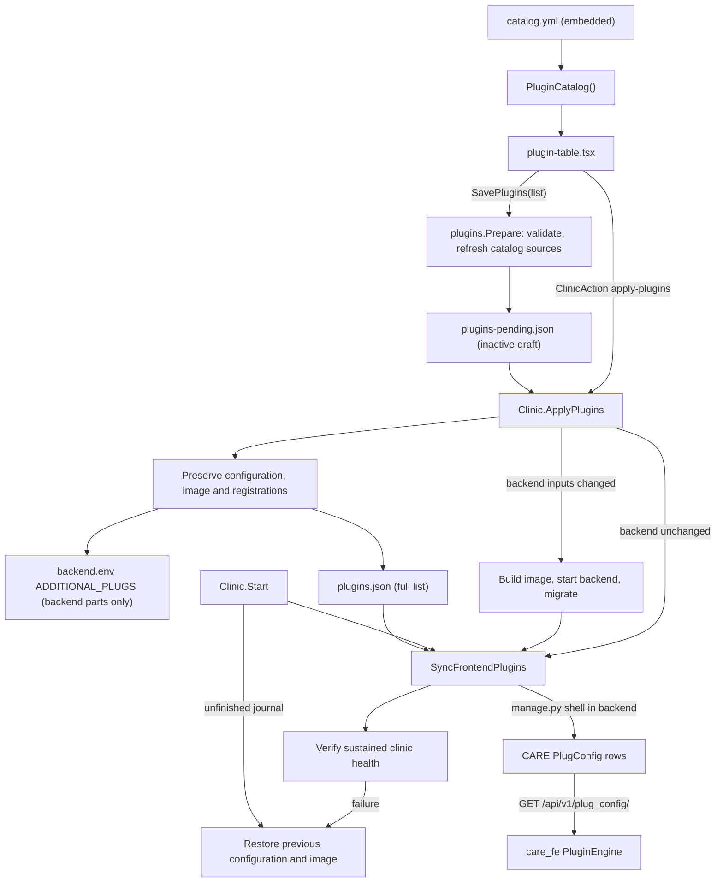

# Plugins

[Documentation index](README.md)

CARE Clinic lets operators add CARE plugins from a bundled catalog, or add custom ones, from the **Plugins** tab. No CARE Clinic admin password is required to view, save or apply plugins. One click on **Save and apply** installs whatever the plugin needs, whether that's a backend part, a frontend part, or both. This includes custom plugin code, so access to the clinic computer should remain restricted to trusted staff.

This guide explains how CARE itself loads plugins, the catalog file format, every component on the desktop side, and how a save flows through them.

## How CARE loads plugins

A CARE plugin is up to two independent pieces that share a name.

| Part | What it is | How CARE loads it | When a change takes effect |
| --- | --- | --- | --- |
| Backend | A Django app, installed with pip. | CARE's `docker/prod.Dockerfile` reads the `ADDITIONAL_PLUGS` build argument and pip-installs `package_name + version` for each entry. At startup `plug_config.py` reads the same JSON: each `name` is appended to `INSTALLED_APPS`, `api/<name>/` is mounted on `<name>.urls`, and `configs` becomes `settings.PLUGIN_CONFIGS[name]`. Plugins read their settings from there first, then from environment variables, then from their defaults. | Only after the backend image is rebuilt. |
| Frontend | A Vite module-federation remote (`remoteEntry.js`), hosted anywhere. | care_fe's `PluginEngine` calls `GET /api/v1/plug_config/`, registers each row's `meta.url` as a federation remote under the row's `slug`, and loads its `./manifest`. The manifest contributes components, overrides, routes, and translations. Each row's `meta` is published to the plugin as `window.__CARE_PLUGIN_RUNTIME__.meta[slug]`. | Next page load. No rebuild needed. |

`PlugConfig` is a plain `slug` + `meta` JSON table in CARE (`care/users/models.py`). CARE's own `/admin/apps` page edits the same rows. The backend never reads this table; it exists only to tell the frontend what to load.

Staff browsers download a frontend plugin's bundle straight from its `url`. If that is a public host such as GitHub Pages, those computers need internet access for the plugin's screens to appear.

## The catalog: `catalog.yml`

[`app/internal/plugins/catalog.yml`](../app/internal/plugins/catalog.yml) lists the plugins offered in the **Add a plugin** menu. It is embedded into the binary with `go:embed`, so changing it requires a new CARE Clinic release. The catalog currently contains CARE Onboarding and [Files on every address](https://github.com/ohcnetwork/care_multihost_files_be) (`care_multihost_files_be`, which makes file links follow the address a request came in on; see [Home access](home-access.md)). Both are enabled by default for new clinic installations only. It also offers [Filly](https://github.com/ohcnetwork/care_filly) (`care_filly`), which is not a default; see [Filly](#filly). Custom plugins and previously saved plugins remain supported.

### Structure

The file is a YAML list. Each item is one catalog entry:

```yaml
- description: One sentence shown under the plugin's name in the panel.
  default: false                 # opt in during new-clinic setup only
  required_configs:               # backend settings that must be filled before saving
    - EXAMPLE_API_KEY
  plugin:
    id: care_example              # required, unique across the catalog
    label: Example                # name shown in the panel
    backend:                      # omit for a frontend-only plugin
      name: care_example          # Python module, goes into INSTALLED_APPS
      package_name: git+https://github.com/org/care_example.git
      version: "@main"            # appended to package_name; quote it
      configs:                    # default backend settings, editable in the panel
        EXAMPLE_API_KEY: ""
    frontend:                     # omit for a backend-only plugin
      slug: care_example_fe       # PlugConfig slug and federation remote name
      url: https://org.github.io/care_example_fe/assets/remoteEntry.js
      meta:                       # default frontend settings, editable as JSON
        config:
          EXAMPLE_API_URL: ""
```

### Field reference

| Field | Required | Meaning | Rules enforced on save |
| --- | --- | --- | --- |
| `description` | No | Subtitle in the panel. Not saved with the plugin. | None. |
| `default` | No | Enable during new-clinic setup. Defaults to `false`; never auto-added on an ordinary read. | Boolean. |
| `add_to_existing` | No | With `default: true`, also add the plugin once to clinics set up before it joined the catalog, the first time they start this CARE Clinic version. See [Defaults for existing clinics](#defaults-for-existing-clinics). | Boolean. |
| `required_configs` | No | Names of `backend.configs` settings the operator must fill in before the plugin can be saved. See [Required settings](#required-settings). | Each listed setting must be present and not blank. |
| `plugin.id` | Yes | Identity of the plugin. Also how a saved plugin is matched back to its catalog entry. | Letters, numbers, `.`, `_`, `-`; unique. |
| `plugin.label` | No | Display name, such as `CARE Onboarding`. Falls back to `id`. | Spaces allowed; surrounding whitespace trimmed. |
| `plugin.backend` | One of `backend`/`frontend` | Present when the plugin has a Django part. | |
| `backend.name` | Yes | The importable Python module. A wrong value stops Django from starting. | Python dotted name; unique across plugins. |
| `backend.package_name` | Yes | Anything pip accepts: a PyPI name, `git+https://…`, or a URL. | Non-empty, no whitespace. |
| `backend.version` | No | Appended to `package_name` with no separator, e.g. `@main`, `@v1.2.0`, `==1.2`. CARE defaults to `@main` when empty. | Must start with `@`, `=`, `<`, `>`, `~` or `!`. |
| `backend.configs` | No | Map of setting name to value. Any YAML scalar, list, or map. Delivered as `settings.PLUGIN_CONFIGS[name]`. | None. |
| `plugin.frontend` | One of `backend`/`frontend` | Present when the plugin has a UI part. | |
| `frontend.slug` | Yes | `PlugConfig.slug`; also the federation remote name and default i18n namespace. | Letters, numbers, `_`, `-`; unique across plugins. |
| `frontend.url` | Yes | Absolute link to the plugin's `remoteEntry.js`. | `http` or `https` with a host. |
| `frontend.meta` | No | Extra keys merged into the `PlugConfig.meta` row. What goes here depends on the plugin. CARE Onboarding uses `meta.config.redirect_after_login`. | Must not contain `url`; set that in `frontend.url`. |

YAML reads an unquoted value that starts with `@` as an error, so always quote `version`. Values are converted to JSON before use, so write them as you want them to appear in `PLUGIN_CONFIGS` or `meta`.

### What the operator can and cannot change

For a plugin added from the catalog, the panel shows only its settings (`backend.configs` and `frontend.meta`). Everything else comes from the catalog: on every save, `Prepare` replaces `label`, `backend.name`, `backend.package_name`, `backend.version`, `frontend.slug`, `frontend.url`, and which parts exist with the current catalog entry, and keeps only the operator's settings.

As a result:

- Bumping a `version` or `url` in the catalog reaches existing clinics the next time an administrator saves plugins after updating CARE Clinic.
- Adding a frontend part to an existing catalog entry turns it on for those clinics at that same save, starting from the catalog's default `meta`.
- Removing an entry from the catalog does not uninstall it anywhere. The saved plugin becomes a custom plugin with the same sources.

### Required settings

`required_configs` lists backend settings a catalog plugin cannot run without, such as an account key. It lives on the catalog entry, not on `plugin.backend`, so it never reaches `plugins.json` or `ADDITIONAL_PLUGS` (CARE builds a strict dataclass from each backend entry and would crash on an unknown key).

- **On save:** `Prepare` rejects a catalog plugin when a required setting is missing, `null`, or a string that is empty or only whitespace, with an error such as `Filly needs MEDISPEAK_API_KEY before it can be installed`. Any other value (a number, `false`, a list) counts as filled. The rule applies only to plugins saved with `catalog: true` whose ID is still in the catalog; a custom plugin with the same module is not checked.
- **In the panel:** `pluginProblems` marks an empty required value with "Enter a value; Filly needs this setting.", and Save and apply stays disabled until it is filled. The name of a required setting is read-only and it has no remove button. `reconcileCatalog` re-adds a required setting that is missing from a saved plugin, with an empty value, so the operator can see what to fill in. A required setting whose name ends in `_API_KEY`, `_SECRET` or `_TOKEN` uses a password field. The value is still stored in plain text in `plugins.json` and `backend.env`, both mode `0600`.
- **Defaults:** a `default: true` entry must ship values for all of its required settings, or new-clinic setup and `AddNewDefaults` would fail to save. `TestEveryCatalogEntryIsValid` checks this.
- **Adding a requirement to an existing entry** makes every clinic that already has the plugin unable to save plugin changes until the setting is filled in, so ship a default value, or add the requirement only to a new entry.

### Adding a catalog entry

1. Confirm the backend module name by checking the plugin's `apps.py` (`AppConfig.name`) or its `PLUGIN_NAME`.
2. Confirm the backend installs with `pip install "<package_name><version>"`.
3. Confirm `url` returns the plugin's `remoteEntry.js`, not a 404 page.
4. List the settings the plugin needs under `configs` and `meta`, with empty or default values, so the operator sees what to fill in.
5. List the settings that have no usable default and that the plugin cannot run without under `required_configs`.
6. Run `go test ./internal/plugins`. `TestEveryCatalogEntryIsValid` fails if any entry breaks the save rules above.

### Filly

[Filly](https://github.com/ohcnetwork/care_filly) (`care_filly`, installed from the `develop` branch) is an AI scribe: Medispeak dictation that fills CARE forms. The catalog entry is backend only. It mounts its API at `/api/care_filly/` and needs two settings, both listed in `required_configs`:

| Setting | Meaning |
| --- | --- |
| `MEDISPEAK_API_KEY` | The clinic's Medispeak account secret (`msk_live_…`). |
| `MEDISPEAK_BASE_URL` | The Medispeak v2 API root. |

The CARE server needs internet access to reach Medispeak. Filly's database tables are created by the `manage.py migrate --noinput` that runs after every plugin apply, so no separate `migrate care_filly` step is needed. Its frontend, `care_filly_fe`, is not in this catalog: enable it from CARE's own plugin marketplace after the backend is applied.

## Desktop components



| Component | File | Responsibility |
| --- | --- | --- |
| Catalog | [`internal/plugins/catalog.yml`](../app/internal/plugins/catalog.yml) | The plugins on offer. |
| Plugin model and storage | [`internal/plugins/plugins.go`](../app/internal/plugins/plugins.go) | `Plugin`, `Backend`, `Frontend`, `CatalogEntry`; `Catalog()`, `Prepare()`, `Manager.ReadPlugins/SavePlugins/FrontendRows`; `ADDITIONAL_PLUGS` dotenv editing. |
| Inactive drafts | [`internal/plugins/pending.go`](../app/internal/plugins/pending.go) | Validate, stage and consume plugin attempts without changing active configuration on save. |
| Engine steps | [`internal/clinic/plugins.go`](../app/internal/clinic/plugins.go), [`plugin_transaction.go`](../app/internal/clinic/plugin_transaction.go), [`plugin_health.go`](../app/internal/clinic/plugin_health.go) | Candidate build/sync, durable apply/rollback, and bounded container/endpoint readiness. |
| Image freshness | [`internal/compose/build.go`](../app/internal/compose/build.go) | `BackendImageCurrent` compares the backend image label with the source ref plus a hash of `ADDITIONAL_PLUGS`. |
| Startup and rebuild hooks | [`start.go`](../app/internal/clinic/start.go), [`rebuild.go`](../app/internal/clinic/rebuild.go) | Sync frontend rows after migrations; a failure is only a warning. |
| Bindings | [`app_plugins.go`](../app/app_plugins.go), [`app_actions.go`](../app/app_actions.go) | `ReadPlugins`, `SavePlugins`, `PluginCatalog`; the `apply-plugins` action. |
| Panel | [`plugin-table.tsx`](../app/frontend/src/screens/panel/plugin-table.tsx) | Catalog picker, custom plugin editor, settings editors, save. |
| Frontend model | [`plugin-model.ts`](../app/frontend/src/screens/panel/plugin-model.ts) | Catalog reconciliation, typed setting round trips and native-compatible field validation. |
| Types | [`types.ts`](../app/frontend/src/types.ts), [`wails.d.ts`](../app/frontend/src/wails.d.ts) | `CarePlugin`, `PluginBackend`, `PluginFrontend`, `PluginCatalogEntry`. |
| Tests | [`plugins_test.go`](../app/internal/plugins/plugins_test.go) | Dotenv round trip, legacy migration, backend/frontend split, validation, catalog refresh, frontend rows, catalog validity. |
| UI tests | [`plugins.spec.ts`](../app/frontend/tests/plugins.spec.ts) | Real editor behavior, failed reads/writes/apply, typed settings, duplicate identities and update/job locks against a simulated host. |

### `plugins.json`

The saved list lives in `plugins.json` in the install directory, next to `backend.env`. It uses mode `0600` and is replaced atomically. It is the source of truth: `ADDITIONAL_PLUGS` and the `PlugConfig` rows are both derived from it. Each item has the same shape as `plugin` in the catalog, plus `catalog: true` when it came from the catalog.

When the file does not exist, `ReadPlugins` builds the list from `ADDITIONAL_PLUGS`. Each entry becomes a backend-only custom plugin. This carries over installations from before the file existed. The first successful apply keeps the new list file; a failed apply restores its absence.

New-clinic `Clinic.Setup` calls `InitializeDefaults` before building images. If `plugins.json` is absent, it preserves those legacy backend entries, adds catalog entries marked `default: true` (without replacing an existing ID), persists the list, and records every default it offered in `plugins-offered.json`. If a list already exists, it is left untouched, including an empty list. Reads, restarts and rebuilds never initialize defaults. Existing clinics must explicitly add CARE Onboarding; removing it and saving keeps it removed.

### Defaults for existing clinics

A catalog entry with both `default: true` and `add_to_existing: true` also reaches clinics set up before it existed. On every start, after the installed kit is refreshed, `refreshInstallDir` calls `AddNewDefaults`, which:

1. Does nothing while `plugins-pending.json` exists, so an unapplied draft cannot overwrite the addition. It tries again on the next start.
2. Takes the `add_to_existing` defaults not yet listed in `plugins-offered.json`.
3. Adds each one that is not already installed. A plugin counts as installed when an entry has the same ID, the same backend module, or the same frontend slug.
4. Saves the list with `SavePlugins`, so `ADDITIONAL_PLUGS` gains the backend part, and records each entry as offered, whether it was added or was already there.

Because the offer is recorded once, removing the plugin afterwards keeps it removed, and a new clinic is never offered the defaults it got at setup again. The plugin is built into the backend the next time CARE starts; a CARE Clinic upgrade already rebuilds the backend image, since the image fingerprint includes the app version. Startup skips this step, like the rest of the kit refresh, while a restore or plugin recovery is unfinished.

`plugins-offered.json` is a sorted JSON list of catalog IDs, mode `0600`, written atomically. `Files on every address` (`care_multihost_files_be`) is the only entry that sets `add_to_existing`.

CARE Onboarding uses the hosted GitHub Pages remote with `{"config":{"redirect_after_login":true}}`. After normal login, it redirects a superuser from the home dashboard to setup only when no facility exists. The CARE frontend must be built with `UserDashboard` included in `REACT_MFE_REGISTERED_COMPONENTS`; the bundled frontend environment sets this for new installations. Existing installations must update their preserved frontend environment and rebuild the frontend. No CARE source changes or new backend endpoint are needed; see [facility setup](onboarding.md#care-compatibility-and-startup).

### `ADDITIONAL_PLUGS`

The domain manager's `SavePlugins`, called during setup or inside the apply transaction, writes only the backend parts to `ADDITIONAL_PLUGS`, as `[{name, package_name, version?, configs?}]` wrapped in single quotes so dotenv does not expand values. The desktop binding of the same name only stages a draft. Frontend data never goes in `ADDITIONAL_PLUGS`, because CARE builds a strict dataclass from each entry and an unknown key would crash the backend at startup. Unrelated lines are preserved, duplicate assignments (including `export` forms) are removed, the result is re-parsed before it is written, and an empty list removes the variable. The settings editor refuses to edit `ADDITIONAL_PLUGS` directly.

### Frontend rows

`FrontendRows` turns every frontend part into one `PlugConfig` row:

```json
{
  "care_onboarding_fe": {
    "name": "care_onboarding_fe",
    "config": { "redirect_after_login": true },
    "url": "https://ohcnetwork.github.io/care_onboarding_fe/assets/remoteEntry.js",
    "managed_by": "care-clinic"
  }
}
```

`name` defaults to the slug and can be overridden in `meta`. `url` and `managed_by` always come from CARE Clinic.

`SyncFrontendPlugins` runs `python manage.py shell -c <script>` in the backend container. The rows are passed through the `CARE_CLINIC_FRONTEND_PLUGINS` environment variable, so settings never appear in command arguments or the log. The script:

1. Upserts each row by slug.
2. Deletes rows with `meta.managed_by == "care-clinic"` that are no longer in the list.
3. Clears CARE's `care_plug_viewset_list` cache so the next page load sees the change.
4. Prints how many rows were registered and removed.

Rows created by hand in CARE's `/admin/apps` are never touched unless they share a slug with a desktop plugin; in that case the desktop's version wins.

## Save and apply

The panel calls `SavePlugins(list)`, which validates and writes a private
`plugins-pending.json` draft, and then `ClinicAction("apply-plugins")`. Saving
does **not** change `plugins.json`, `backend.env`, or the running clinic.
`ReadPlugins` returns the active list, not this draft. Both operations require
an installed server with no unfinished restore or plugin rollback; neither
requires a CARE Clinic admin password. Explicit rebuild actions remain protected.

Plugin application now requires a running, healthy clinic. Start it from
Overview first if it is stopped. `ApplyPlugins`:

1. Consumes the staged draft and verifies every configured container and the
   clinic's HTTPS `/ping/` endpoint for 30 continuous seconds.
2. Pins the currently running backend image under a safety tag and atomically
   saves a private `plugin-recovery.json`. It preserves the exact previous
   `backend.env`, `plugins.json` (including absence), `channel.lock`, container
   metadata, and affected frontend registration rows, including manual rows
   sharing a candidate slug.
3. Writes the candidate configuration. Changed backend inputs trigger a
   rebuild, worker stop, backend start, migrations, frontend sync, and service
   startup. A queued backend update built with old plugin inputs is invalidated.
   Frontend-only changes just sync registrations, without restarting services.
4. Requires another 30 seconds of continuous container and endpoint health
   before removing the journal and reporting success. Readiness has a
   three-minute deadline and detects missing, exited, unhealthy and restarting
   containers, replacement containers, and restarts even between polls. Compose
   startup waits are bounded, and the complete apply attempt has a 20-minute
   deadline.
5. On build, write, migration, sync, startup, or health failure, restores the
   saved files, image tag, and frontend rows, then recreates the backend/workers
   from the preserved image without downloading, rebuilding, applying queued
   updates, or running migrations again. Recovery has its own eight-minute
   deadline and must pass the same readiness checks before saying CARE is back
   online. Volumes are never removed.

If recovery fails, the error says CARE could not be recovered and the journal
and safety image remain. Overview exposes **Recover clinic**, which runs
`Start`. Start checks the journal before any normal startup/build/update work;
reopening CARE Clinic also requests this recovery. Other configuration mutations
are blocked until it finishes. An interrupted attempt is therefore rolled
back rather than retried with the bad plugin inputs. Do not delete the journal
or prune the safety image while recovery is pending.

The editor waits for the matching `care-done` event before treating settings as
applied. New or changed entries are marked **Not applied** until the job succeeds.
After failure it shows whether recovery succeeded and keeps the failed batch
visible for correction only while the operator stays on Plugins. Leaving the
tab discards that batch and restores the last successfully applied list,
including any existing plugins removed or edited by the failed attempt. A
failure that arrives while another tab is open discards the batch too. An
explicit retry on Plugins stages the draft afresh; successful changes remain
when switching tabs. Ordinary unsaved edits and file-save errors still retain
their drafts across tabs.
Private native diagnostics stay in the log rather than the error banner.

**Limits:** this is configuration/image/runtime recovery, not a database
point-in-time restore. Plugin migrations and external side effects cannot
generally be reversed safely; newly created tables/data remain. An incompatible
or destructive migration can still prevent the previous backend from becoming
healthy, in which case recovery is reported as unfinished. Keep backups and
only install trusted plugins. Hosted frontend assets are downloaded by staff
browsers; successful clinic readiness does not validate those remote bundles.

Regression coverage in `plugin_transaction_test.go` injects build, partial
configuration-write, startup, migration, sync, readiness, and recovery failures.
`plugin_health_test.go` covers crash loops, missing services, health timeouts,
and the stability window. To exercise the real Docker metadata and frontend
snapshot queries **without changing a running clinic**, run from `app/`:

```sh
CARE_PLUGIN_READONLY_INSTALL_DIR="/path/to/installed/clinic" \
  go test ./internal/clinic -run '^TestPluginLiveReadOnlyPreflight$' -count=1 -v
```

This read-only check is not an end-to-end failing-plugin rollback test. For
that test, use a disposable or backed-up clinic, stop competing Desktop
processes, then use **Save and apply** with a known-bad plugin configuration.

`Start`, and so every rebuild, also syncs after migrations. There a failure is only logged as a warning, because a missing plugin screen is less harmful than a clinic that will not start. Syncing on every start also repairs rows after a database restore or a hand edit in CARE's admin.

## The panel

- **Add a plugin** lists catalog entries whose plugin ID, backend module and frontend name are not already in the list, then **Custom plugin**. This includes custom entries using the same identities. A newly added plugin opens expanded.
- Each plugin shows **Backend**, **Frontend**, and **Custom** badges as they apply, and a remove button. Removing a plugin and saving uninstalls both parts: the backend is rebuilt without it and its `PlugConfig` row is deleted.
- **Backend settings** are key/value rows. `true`/`false`, integers, decimals, and text starting with `[` or `{` (parsed as JSON) are converted to the matching type; anything else stays a string.
- **Frontend settings** are the raw `meta` JSON object, the same format as CARE's `/admin/apps` editor. Invalid JSON, or a value that is not an object, disables saving.
- **Custom plugins** show a **Display name** (spaces allowed) separately from the required **Plugin ID** (letters, numbers, `.`, `_`, `-`; no spaces). Invalid or duplicate IDs have inline errors and block saving. They also show a switch for each part, the backend module, pip source and version, and the frontend name and `remoteEntry.js` URL.

The catalog/table layout is retained. Unchanged backend settings preserve their
original JSON types, including strings that look numeric or boolean, nulls and
structured values. Parsing applies to edited values; the frontend metadata must
be an object. A custom plugin may have either part or both, the backend version
can be omitted, and a local HTTP frontend URL is allowed just as in native
validation. Only configure sources the clinic trusts.

Saved-plugin and catalog reads have independent retry states. Another clinic
job, a pending restore/plugin recovery or an unresolved Desktop update disables mutations while
preserving the draft. Readable errors distinguish a failed load, a failed save,
and unapplied drafts whose loading failed. These are frontend protections in
addition to the native stable-clinic and operation guards.

## Troubleshooting

| Symptom | Likely cause |
| --- | --- |
| Plugin loading fails | CARE Clinic restores the previous configuration and image. Check the log for missing settings, `ModuleNotFoundError`, or startup failures, correct the draft, and save again. |
| Plugin recovery is unfinished | Use **Recover clinic** in Overview. Keep the recovery journal, safety image and backups; if recovery still fails, share the log with support. |
| Rebuild fails during `pip install` | Wrong `package_name`/`version`, a private repository, or no internet during the build. |
| Plugin UI does not appear | The browser cannot reach `frontend.url`, the URL is not a `remoteEntry.js`, or the log shows the sync warning. The browser console names the slug that failed. |
| A setting has no effect | Backend settings apply only after the rebuild that saving triggers. Frontend settings apply on the next page load. Check that the key is what the plugin actually reads. |
